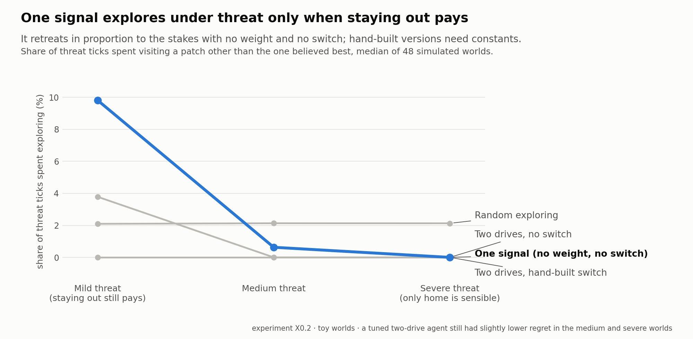
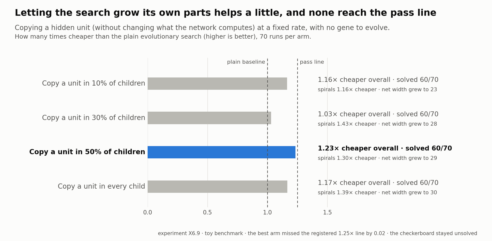
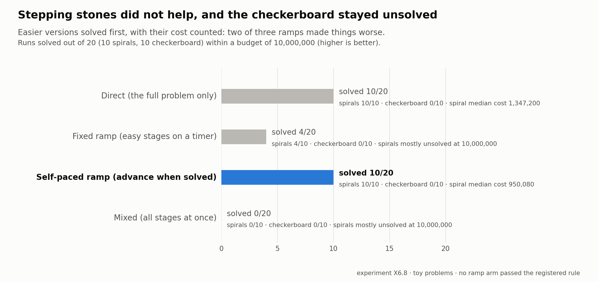
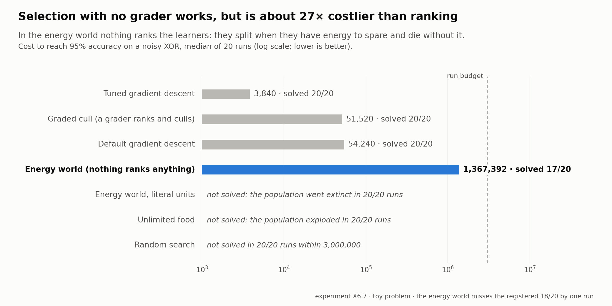
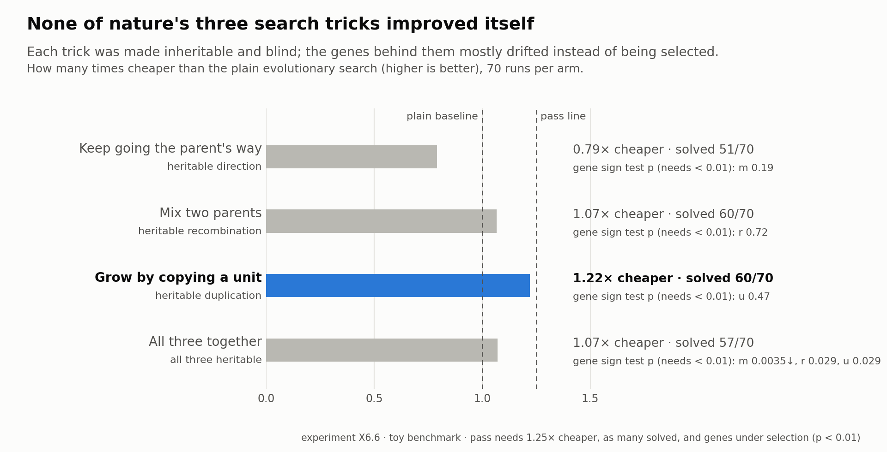
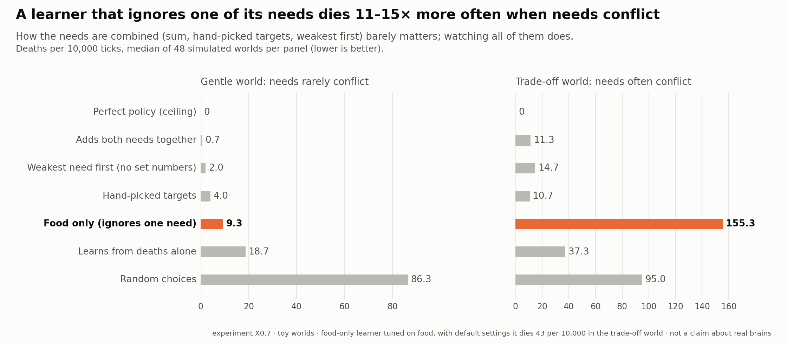
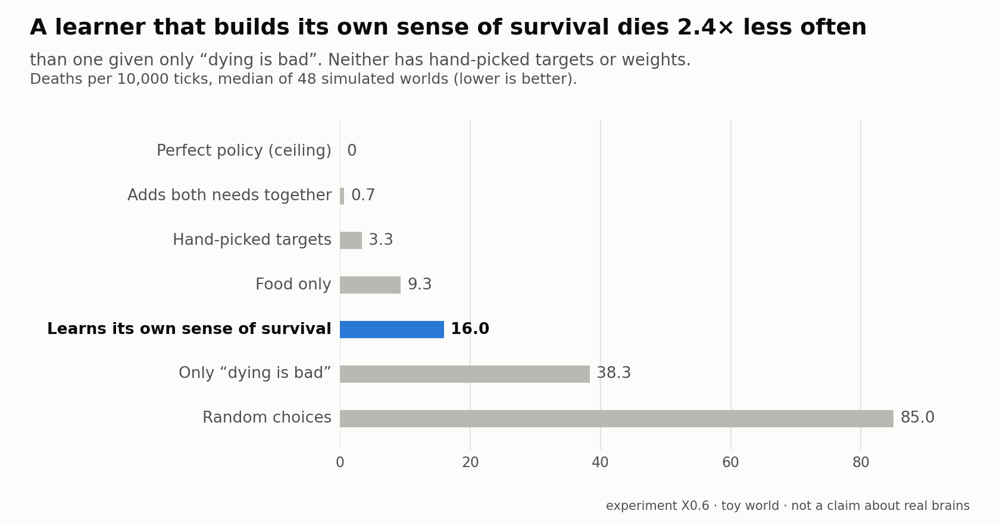

# Vertical Intelligence

A deep dive into **evolution and the nature of intelligence**, with the express goal of applying
what it finds to **machine learning**. The question underneath everything: how did nature
produce minds that get *better at learning itself*, not just better at one task, and what would
a machine learner built on those principles look like? The work combines biology (evolution,
how brains work), psychology (motivation, curiosity, the parts of the self) and computer
science, and tests each idea with small, carefully controlled computer experiments.

> **"Vertical" intelligence** means growth in *how well* a learner learns: each new problem is
> solved faster and with less effort because it connects to everything learned before, and the
> learner knows where its own understanding ends. Most of today's machine learning is trained
> hard on one goal; this program asks what evolution and the brain do that is missing from that picture.

The long-term milestone is a model that, given only the science known before 1900 and the
measurements of that time, works out on its own that something like quantum theory must exist.

**Stage: early and exploratory.** Every experiment here runs in a small simulated "toy world"
on a laptop. The results are principles shown in miniature, not claims about real brains or
about large AI systems.

## Latest update: 27 October 2026

**At a glance: 241 pre-registered predictions, 103 passed, 130 failed, 0 awaiting results** (8 more were voided or not applicable).
Every success rule is written down *before* an experiment runs, and every failure is kept and
reported next to the successes.

<picture>
  <source media="(prefers-color-scheme: dark)" srcset="curious-net/results/figures/vi_x02_secure_base_dark.png">
  
</picture>

Data behind the chart (experiment X0.2, median of 48 worlds per type)

| Agent | Exploring under threat (mild / medium / severe world) | Exploring while calm | Regret per tick (medium world) |
|---|---|---|---|
| **One signal: expected change for me, sampled; no weight, no switch** | **9.8% / 0.6% / 0.0%** | 10.7% | 0.0018 |
| Two drives, hand-built switch (one tuned weight) | 0.0% / 0.0% / 0.0% | 3.9% | 0.0016 |
| Two drives, no switch (one tuned weight) | 3.8% / 0.0% / 0.0% | 4.0% | 0.0017 |
| Random exploring (one tuned rate) | 2.1% / 2.1% / 2.1% | 2.1% | 0.0042 |

A signal that combines the safety cost and the value of learning into one expected-change-for-me
produced the toddler pattern (explore when safe, retreat under threat, resume at once, and retreat
in proportion to the stakes) with nothing to tune. It was not better than a two-drive agent with one
tuned weight, which had slightly lower regret; the hand-set weight happened to transfer across all
three worlds. So one hunger is enough, but not shown to be better.

<picture>
  <source media="(prefers-color-scheme: dark)" srcset="curious-net/results/figures/vi_x69_growth_dark.png">
  
</picture>

Data behind the chart (experiment X6.9, 70 runs per arm)

| Growth rate (copy a hidden unit, same output) | Solved | Cheaper overall | Cheaper on spirals | Final net width |
|---|---|---|---|---|
| None (plain search) | 60/70 | 1.00x | 1.00x | 16 |
| 10% of children | 60/70 | 1.16x | 1.16x | 23 |
| 30% of children | 60/70 | 1.03x | 1.43x | 28 |
| **50% of children** | **60/70** | **1.23x** | **1.30x** | **29** |
| Every child | 60/70 | 1.17x | 1.39x | 30 |

The pass line registered in advance was 1.25x overall; the best arm missed it by 0.02. The
checkerboard stayed unsolved at every rate, even with nets grown to width 30. Letting the search
grow its own parts helps a little; it is not the missing ingredient.

<picture>
  <source media="(prefers-color-scheme: dark)" srcset="curious-net/results/figures/vi_x68_stones_dark.png">
  
</picture>

Data behind the chart (experiment X6.8, 10 runs per problem per arm)

| Approach | Solved (of 20) | Spirals | Checkerboard |
|---|---|---|---|
| Direct: the full problem only | 10 | 10/10 (median cost 1,347,200) | 0/10 |
| Fixed ramp: easy stages on a timer | 4 | 4/10 | 0/10 |
| Self-paced ramp: advance when the stage is solved | 10 | 10/10 (median cost 950,080, from 508k to 6.0M) | 0/10 |
| Mixed: all stages at once | 0 | 0/10 | 0/10 |

Every stage's cost is counted. The easier versions were a quarter turn growing to 1.6 turns for the
spirals, and a 2x2 grid then 3x3 for the checkerboard. None of the three stepping-stone arms met the
registered pass rule (more runs solved, or 1.5x cheaper).

<picture>
  <source media="(prefers-color-scheme: dark)" srcset="curious-net/results/figures/vi_x67_nograder_dark.png">
  
</picture>

Data behind the chart (experiment X6.7, 20 runs per arm)

| Learner | Solved | Median cost to 95% |
|---|---|---|
| Tuned gradient descent | 20/20 | 3,840 |
| Graded cull (a grader ranks and culls) | 20/20 | 51,520 |
| Default gradient descent | 20/20 | 54,240 |
| **Energy world, per-point energy (nothing ranks anything)** | **17/20** | **1,367,392** |
| Energy world, literal per-step energy | 0/20 (population went extinct in 20/20) | n/a |
| Unlimited food | 0/20 (population exploded in 20/20) | n/a |
| Random search | 0/20 | n/a |

In the energy world, food is shared among the learners that answer correctly, living costs energy,
a learner with spare energy splits in two and one with none dies. Accuracy predicted the number of
offspring in every run. The registered pass mark was 18/20, so the energy world missed it by one
run; the literal reading of the units collapsed, so the energy scale matters.

<picture>
  <source media="(prefers-color-scheme: dark)" srcset="curious-net/results/figures/vi_x66_machinery_dark.png">
  
</picture>

Data behind the chart (experiment X6.6, 70 runs per arm)

| Search trick (each inheritable and blind) | Solved | Cheaper than plain search | Gene moved away from its random start? |
|---|---|---|---|
| Keep going the parent's way | 51/70 | 0.79x | no (p = 0.19) |
| Mix two parents | 60/70 | 1.07x | no (p = 0.72) |
| Grow by copying a unit | 60/70 | 1.22x | no (p = 0.47) |
| All three together | 57/70 | 1.07x | one did, downward (p = 0.0035); two did not (p = 0.03) |

Plain search solves 60/70. A trick passes with at least as many solved, 1.25x cheaper, and genes
shown to be under selection (p < 0.01). The growth trick still solved the spiral problem 1.7x
faster, with a gene that did not evolve: the *capacity* to grow helped; its evolved rate did not.

<picture>
  <source media="(prefers-color-scheme: dark)" srcset="curious-net/results/figures/vi_x07_needs_dark.png">
  
</picture>

Data behind the chart (experiment X0.7, median of 48 simulated worlds per column)

| Learner | Gentle world | Trade-off world |
|---|---|---|
| Perfect policy (exact ceiling) | 0.0 | 0.0 |
| Adds both needs together | 0.7 | 11.3 |
| Weakest need first (no hand-picked numbers) | 2.0 | 14.7 |
| Hand-picked targets | 4.0 | 10.7 |
| **Food only (ignores one need)** | **9.3** | **155.3** |
| Learns from deaths alone | 18.7 | 37.3 |
| Random choices | 86.3 | 95.0 |

The food-only learner is tuned on food, its own objective; with default settings it dies 43.3 per
10,000 ticks in the trade-off world, still about four times more than the others.

<picture>
  <source media="(prefers-color-scheme: dark)" srcset="curious-net/results/figures/vi_x06_deaths_dark.png">
  
</picture>

Data behind the chart (experiment X0.6, median of 48 simulated worlds)

| Learner | Deaths per 10,000 ticks |
|---|---|
| Perfect policy (exact ceiling) | 0.0 |
| Adds both needs together | 0.7 |
| Hand-picked targets | 3.3 |
| Food only | 9.3 |
| **Learns its own sense of survival, from deaths alone** | **16.0** |
| Only "dying is bad" | 38.3 |
| Random choices | 85.0 |

- **Finished this week:** the first experiments on the "good or bad *for me*" question (X0.1,
  X0.1b, X0.6, X0.7), and a four-part test of how nature could have searched before gradient
  descent (X6.5 to X6.8): a repaired benchmark, search tricks that did not improve themselves,
  selection with no grader at all (it works, at about 26 times the cost of ranking), and stepping
  stones (they did not help). The main result on "for me": what decides whether a simulated creature
  survives is whether it attends to *all* its needs (X0.7).
- **Also finished:** letting the search grow its own parts by copying hidden units (X6.9) helps by
  about 1.2 times, but is not the missing ingredient.
- **Also finished:** a test of the author's theorem that comfort-seeking and growth are one hunger
  (X0.2): a single "expected change for me" signal is enough to explore when safe and retreat under
  threat, with nothing to tune, though not better than a tuned two-drive design.
- **Next:** what happens when a part's warning is ignored: does the cost grow until breakdown (X0.4)?

## What has been found so far

Each result has an id (like C43) and a confidence letter: **R** = replicated on fresh data,
**S** = supported once, **P** = partly supported, **D** = a diagnosis only, **N** = not supported.

- **Learning transfers in proportion to shared structure.** A learner that has seen related
  problems solves new ones up to 7.5x faster; on unrelated problems it gains nothing, as it should (C43, R).
- **Less is more, repeatedly.** Giving a learner an "energy budget" for its connections cuts its
  error in unfamiliar situations by 12.8% while using 5% of the connections (C41, R). Focused
  models and sparse connections win in other tests too (C47, C50).
- **Curiosity's proven job is avoiding what cannot be learned**, rather than choosing between
  learnable things (C40). **Motivation plus curiosity** beats either one alone (C52, R).
- **Order of teaching matters.** Easy-to-hard lessons are 2.4x cheaper than random order (C53, R).
  A student taught only correct facts is confidently wrong outside them (C31, S).
- **Knowing "which situation am I in?"** is the shared bottleneck behind several abilities:
  mastery, using specialised parts, and memory (C44-C46, D).
- **A brain's wiring diagram gets you about halfway.** Using the real fruit-fly connectome,
  whether each connection excites or inhibits matters most (C42, R).
- **Laws from real data.** Kepler's third law was rediscovered from real NASA planetary data,
  and deliberately wrong theories were rejected (C57).
- **Evolution without calculus.** Starting from pure random networks, blind random changes plus
  "survival of the fittest" solve learning problems with no gradient descent (the calculus-based
  method that trains modern AI). On seven test problems it solved 60 of 70 runs within its
  budget, at about 0.6x the cost of gradient descent with standard settings, but still about 11x
  behind well-tuned gradient descent; one problem (a 3x3 checkerboard) it never solves. These are
  the repaired numbers from X6.5, which replaced an earlier, more flattering 0.5x and 9x.
  Current question: how could nature have optimized life before anything like gradient descent existed?
- **Attending to every need is what keeps a creature alive.** In simulated worlds a creature that
  ignores one of its two needs dies 2 to 14 times more often in a gentle world and 11 to 15 times
  more often when the needs conflict; how the needs are combined (a sum, hand-picked targets, "weakest
  first" with no hand-picked numbers) barely matters (X0.7). A creature that must learn its own
  sense of survival from experience of dying does half as badly as one given only "dying is bad",
  but deaths alone are too rare to teach it well (X0.6).

Failures are kept and reported alongside successes; the logs record every attempt.

## How to explore it

If you are reading for the ideas, start here:

1. [`program/wiki-domains/vertical-intelligence/wiki/research-protocol.md`](program/wiki-domains/vertical-intelligence/wiki/research-protocol.md):
   the program's charter. Section 1 lists the author's founding statements (U1-U18) and the
   main open questions (Q1-Q10).
2. [`program/wiki-domains/vertical-intelligence/wiki/findings-map.md`](program/wiki-domains/vertical-intelligence/wiki/findings-map.md):
   what has been learned, organised by topic.
3. [`program/wiki-domains/vertical-intelligence/wiki/dialogue-prediction-is-not-the-whole-story.md`](program/wiki-domains/vertical-intelligence/wiki/dialogue-prediction-is-not-the-whole-story.md):
   a long argument about whether prediction is all there is to intelligence (randomness,
   imagination, boredom, wholeness).
4. [`program/wiki-domains/vertical-intelligence/wiki/experiment-plan.md`](program/wiki-domains/vertical-intelligence/wiki/experiment-plan.md):
   every planned experiment and what would count as success.
5. [`neuroblock-research/emergent/README.md`](neuroblock-research/emergent/README.md): the
   "evolution without calculus" experiments in one page.

If you want to see the raw work, each line's `LOG.md` records every experiment in order, failures included.

## How it is organized

| Folder | What is inside |
|---|---|
| `program/` | The research notebook: charter, plan, findings, literature, and the author's own statements in `raw/` (word for word, except personal reflections, which are summarized) |
| `curious-net/` | The main experimental code: curiosity, teaching, self-doubt, discovering laws from data, and `vi/` (the newest experiments, X0.x) |
| `neuroblock-research/` | The earlier line: a brain-like simulator with parts, sleep and mastery, plus the evolution experiments in `emergent/` |
| `tools/` | `sync.py` refreshes this repository from the working copies; `publish.py` checks it for anything that should not go public and publishes it |

## Words used in the notes

| Term | Meaning |
|---|---|
| U1, U2, ... | The author's founding statements ("givens"), taken as starting points |
| Q1, Q2, ... | The program's open research questions |
| P-draft, P-number | A proposed test; it becomes a numbered prediction once its pass/fail rule is written down *before* it runs |
| C1, C2, ... / X0.1, X6.6 ... | Ids of finished results / of experiments in the current plan |
| Toy world | A small simulated environment built to test one idea cleanly |
| Seed | One independent random run; results are reported across many seeds |
| Gradient descent, Adam | The standard way modern AI is trained (Adam is its most common version) |
| Pre-registered | The success rule was fixed before the experiment ran, so it cannot be bent afterwards |

## Running the code

Python 3.11 with numpy, scipy, torch and matplotlib. Run scripts from their folder; the top of
each script says how (for example `python emergent/confirm.py` inside `neuroblock-research/`
reproduces the main evolution result in a couple of minutes). Raw third-party data is not
included; sources are listed in `curious-net/paper/LITERATURE.md`. AI agents working on the
repository should start at [`AGENTS.md`](AGENTS.md).

## Credits

The research direction, the founding statements and every redirect are the author's. Most of
the code, experiment write-ups and logs were produced by AI coding assistants (Anthropic's
Claude) working under the author's direction. Details and data sources are in
[`CREDITS.md`](CREDITS.md). [`SNAPSHOT.md`](SNAPSHOT.md) records when this copy was last refreshed.
