# Neuron-block sweep: findings (2026-10-18)

Plain-English summary of the one-variable-at-a-time sweep: 28 settings, 4 task conditions with every feature on, plus 2 where each feature is added alone to a bare brain; 24 random seeds each; 9,744 simulated lifetimes. Each result is compared with its reference using the same seeds ("paired"), and a difference counts as a real effect when the paired z-score is above 3 (roughly: it would occur by luck less than 1 time in 300).

Raw data: `sweeps/raw_runs.csv`, `sweeps/results.json`, `sweeps/plan.json`. Tables: `sweeps/analysis_tables.md`. Graphs: `sweeps/graphs/`. Code: `sweep.py`, `analyze.py`.

Across 9,744 simulated lifetimes three things dominate: how picky neurons are (the matching radius), how noisy and wide the task is, and which neuron answers when several match. Letting neurons move and pruning the unused ones give big speed and size wins for free. The 'always expand' and 'hardening' ideas have not paid off yet.

## Findings

### The matching radius (rho) is the dial that matters most  _(info)_

rho is how picky a neuron is about what it will claim. Too picky (0.2): about 700 neurons and only 65% right. Too loose (1.0): just 6 neurons that lump different categories together, 64% right. The sweet spot is about 0.5 (99.3% right). This is the same dial as 'vigilance' in Adaptive Resonance Theory, and it behaves the way that theory predicts.

### When the brain is wrong, the wrong neuron answered, not a missing one  _(supports)_

Even on the hardest tasks the brain recognises about 99% of inputs, yet only 79-88% are right. Changing the rule from 'the fastest neuron answers' to 'the best-fitting neuron answers' lifts accuracy from 79.4% to 94.9% (hard task, categories replaced) and 88.4% to 97.2% (hard task, categories slide). The price is about 7-10 microseconds. This confirms the handoff's claim that speed-first selection lets shallow neurons steal inputs.

### Letting neurons move makes thinking about 3x faster, at no cost  _(supports)_

With movement on, an average thought takes 31 µs; with it off, 94 µs. Accuracy did not change in any test. Pruning (deleting unused neurons) cuts the brain from about 25 neurons to 11 with no accuracy loss. Merging near-duplicates helps a little, but only borderline (just short of our 'real effect' bar).

### The speed floor is a geometry setting, not a law of the brain  _(info)_

The minimum spacing between neurons (min_sep) sets the speed limit: 0 gives 5 µs, 0.3 gives 31 µs, 0.8 gives 84 µs, while accuracy and size stay exactly the same. So the 'about 30 µs floor' is mostly 'how close neurons are allowed to sit'. 'Instant thought' (0 µs) only happens if neurons can overlap. The microsecond-per-distance setting scales time exactly in proportion, which is a good sanity check.

### The 'always try to expand' drive does nothing yet  _(contradicts)_

Switching it on makes about 25 accepted expansions per run, yet accuracy, speed and size do not change in any of the four tasks, even on the hardest one where there is room to improve (79.4% either way). On a bare brain it just adds about 10 neurons (26.8 to 36.8) with no gain. Why: it looks for inputs that no neuron explains well, but the brain already covers 99% of inputs. The mistakes come from the wrong neuron answering, so a new neuron doesn't help.

### Hardening makes thinking slower and does not make results steadier  _(contradicts)_

Turning hardening on slows an average thought by 10-15 µs (31 to 41 on the medium task, 29 to 44 on the hard one) with no accuracy gain. The handoff said it halves the run-to-run variation, but with 24 repeats we don't see that (medium task: 0.9% to 1.6%; hard task: 5.7% to 5.6%). One handoff claim does hold: very strong hardening (c0 = 3) bloats the brain (25 neurons instead of 11; 38 instead of 21 on the hard task).

### Noisier or wider worlds break a fixed matching radius  _(info)_

With more noise (sigma 0.3) or more input signals (D = 32), accuracy collapses to 40% and 15%, coverage falls to 49% and 15%, and the neuron count explodes to about 870 and 1,090, because no neuron is allowed to match anything. The brain cannot loosen its own pickiness. This is exactly where your 'reward only while uncertainty is dropping' idea could plug in: a self-adjusting radius.

### Replacing categories is harder than sliding them  _(info)_

Brand-new categories are harder than shifted ones: accuracy 95.6% vs 99.3% on the medium task and 79.4% vs 88.4% on the hard task. After replacement the brain also needs about 1.6-2.8 cleanup rounds to recover, versus almost none after a slide.

### Three cautions about how things are measured  _(mixed)_

(1) Accuracy counts common categories more. With a very skewed world (zipf 2) accuracy looks higher (hard task: 78% to 96% as skew rises from 0 to 2) without the brain being any smarter. A balanced accuracy would be fairer. (2) The original fitness score rates 'best-fit' selection no better than 'fastest' (0.369 vs 0.369) even though accuracy rises 15 points, so how we weigh accuracy against speed and size is a choice we should make on purpose. (3) Everything here is a toy task and says nothing about real brains.

### Scorecard of the handoff's claims  _(mixed)_

Reproduced: the condensing numbers (94 to 31 µs, 27 to 11 neurons); fast vs best selection; strong hardening bloats the brain; the expansion drive is inert; the speed floor depends on min_sep. NOT reproduced: 'hardening halves the variation between runs'. New: expansion stays inert even when there is room to improve, and three settings (inputs D, noise sigma, radius rho) matter far more than everything else.

## Does it line up with the research and what you said?

| Principle / claim | In the simulator? | What the tests show | Verdict |
|---|---|---|---|
| Everything is measured in time from A to B (microseconds). Instant thought = 0 µs, average thought about 100 µs. | Yes: signal travel time in µs. | A brain with no condensing averages 94 µs, close to your 100 µs 'average thought'. Condensing brings it to 31 µs. 0 µs only appears if neurons overlap (min_sep = 0 gives 5 µs). | **supports** |
| Neurons live on a physical graph and can move. | Yes: a 2D map where neurons slide toward the neurons they talk to most. | Moving cuts thought time about 3x (94 to 31 µs) with no accuracy loss, in all conditions. | **supports** |
| The base instinct is EXPANSION (spawn on unexplained input). | Yes: an unrecognised input creates a neuron. | It works, and runs away when matching is too strict: up to about 1,100 neurons at D = 32. Batteries (store/release activation) are not built yet. | **supports** |
| The brain condenses toward a compact shape; fitness = best result per unit effort. | Yes: move, merge, prune. | Prune halves the neuron count and move makes thought 3x faster, both free. But the fitness score itself undervalues accuracy (best-fit selection: +15 points, same score). | **supports** |
| The brain should ALWAYS attempt to expand; expand when it satisfies the most neurons. | Partly: it proposes neurons for poorly explained recent inputs, not by 'neuron votes'. | No effect in any of four tasks, even with room to improve. It adds about 10 neurons on a bare brain for no gain. The errors come from the wrong neuron answering, not from missing neurons. | **contradicts** |
| Neurons become progressively harder to affect over time (hardening). | Yes ('rigid'). | Slower thinking (+10-15 µs), no accuracy gain, not steadier between runs. Strong hardening bloats the brain. | **contradicts** |
| Outside signals are trusted with decaying relevance; internal signals are biased data. | No. | Not tested yet. | **untested** |
| Spawning should not happen if it is negative for the whole. | No (the brain always spawns). | Not built, but the runaway spawning at high noise or many inputs (about 1,000 neurons, 15% accuracy) shows a 'negative for the whole' check would have a real job to do. | **untested** |
| Reward time on a problem only while uncertainty is dropping. | No. | Not built. The matching radius (rho) is the most sensitive setting in the whole simulator and is fixed by hand, so a self-adjusting radius driven by uncertainty is the natural first test of this idea. | **untested** |
| Research: Adaptive Resonance Theory (vigilance, stability vs plasticity). | Yes, loosely. | rho behaves like vigilance (too picky = many categories, too loose = over-general). Strong hardening causing bloat mirrors the stability-plasticity trade-off. | **supports** |
| Research: Internal Family Systems / Society of Mind (parts coordinated by a Self). | No coordinator yet. | The neurons act as independent specialists; there is no Self-style coordinator, so these ideas have not been tested. | **untested** |

## Graphs

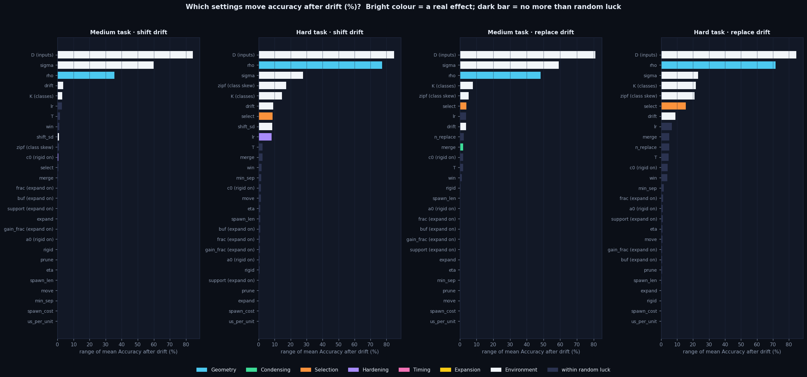
*Which settings change accuracy the most? Longer bar = bigger effect. Bright bars are real effects; dark bars are no more than luck. Inputs (D), noise (sigma) and the matching radius (rho) dominate.*

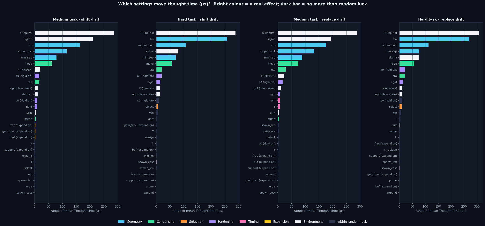
*Which settings change thought time the most? Besides the matching radius, the spacing between neurons (min_sep), the unit conversion, and whether neurons move are what set the speed.*

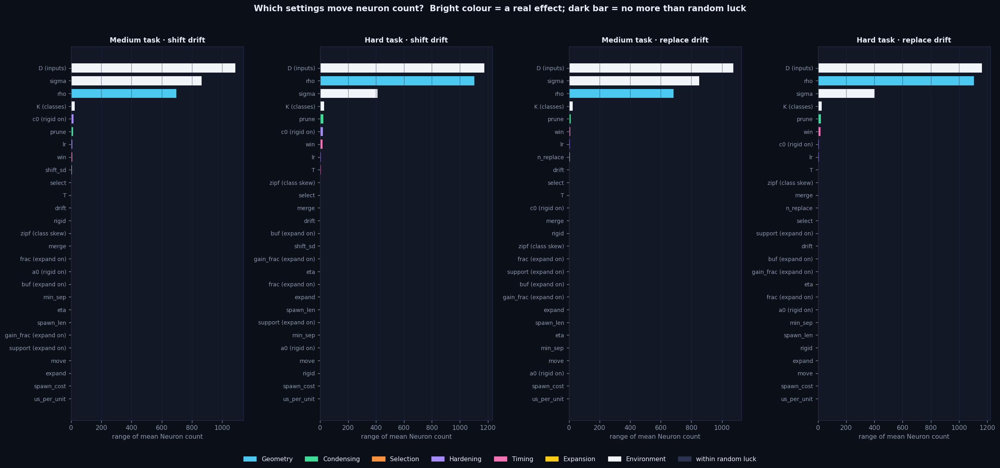
*Which settings change how many neurons the brain ends up with? Radius, noise and inputs cause explosions; pruning and cleanup frequency (win) also matter.*

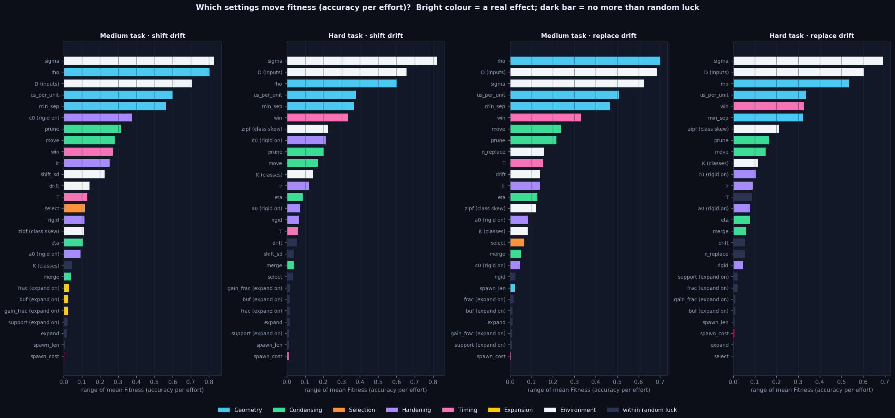
*The same ranking for the original 'fitness' score (accuracy per unit of time and size).*

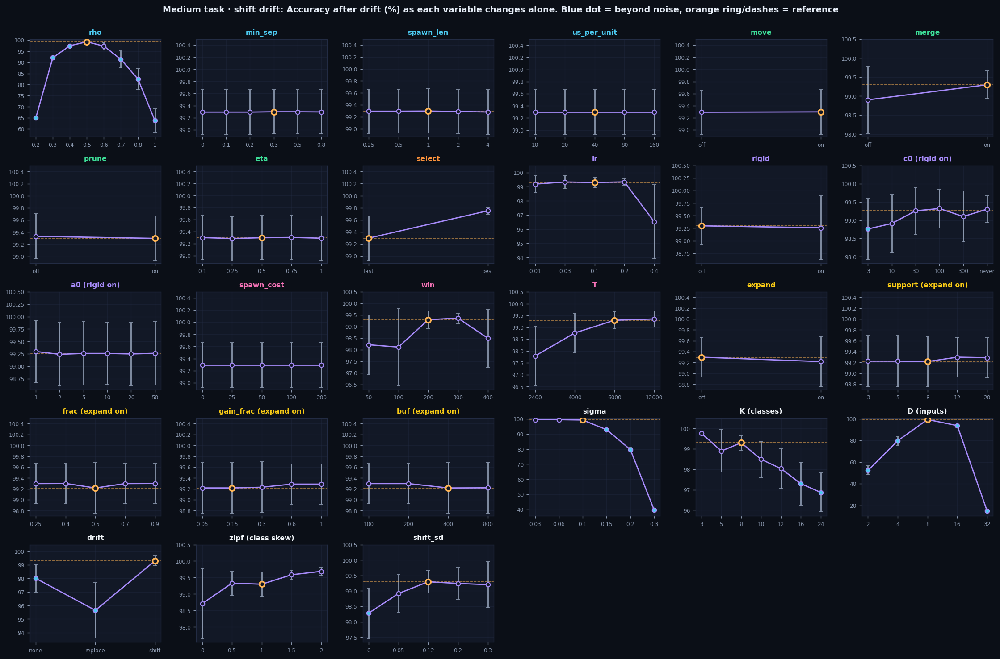
*Medium task: accuracy as each setting changes alone. A dot with a blue fill is a real change from the reference.*

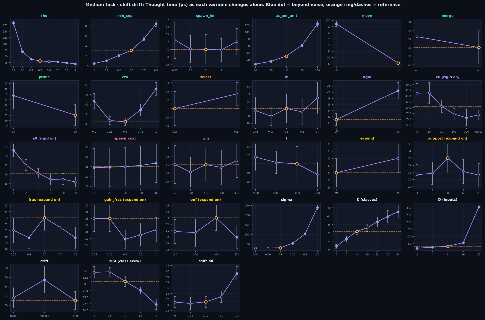
*Medium task: thought time as each setting changes alone. Moving neurons and the spacing limit give the big speed changes.*

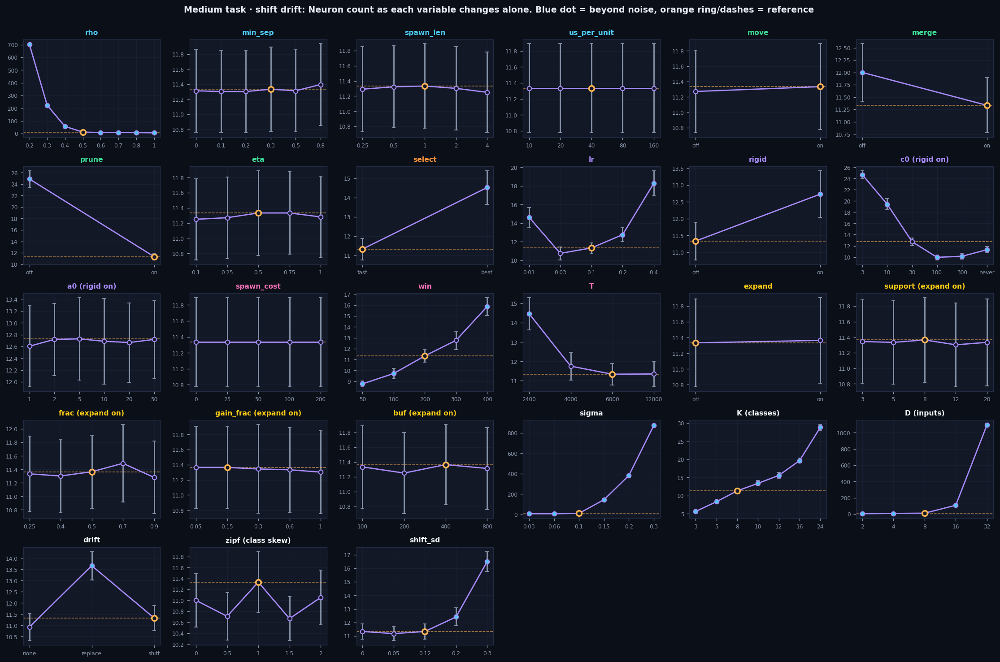
*Medium task: brain size as each setting changes alone.*

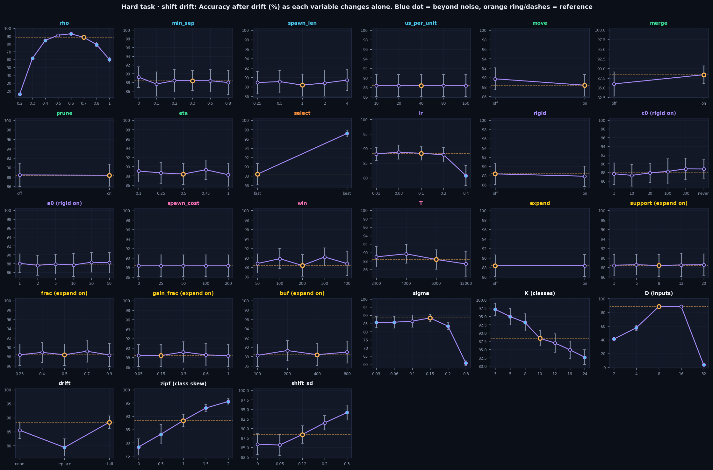
*Hard task: accuracy as each setting changes alone. Here the choice of selection rule ('fast' vs 'best') is a big lever.*

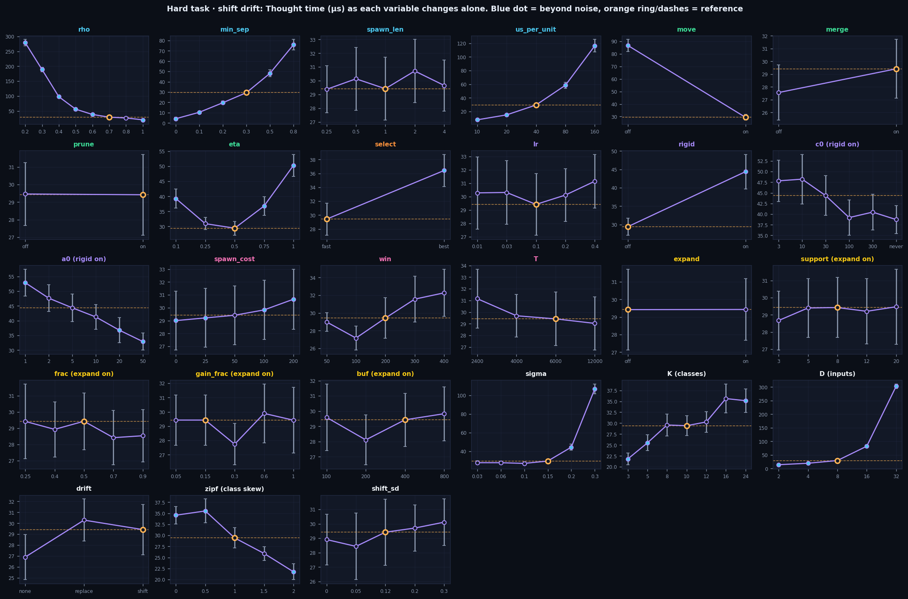
*Hard task: thought time as each setting changes alone.*

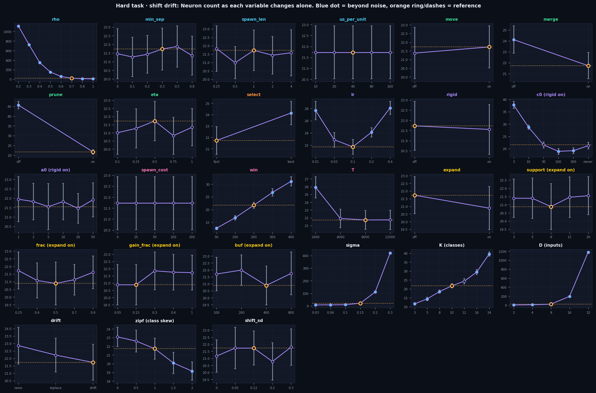
*Hard task: brain size as each setting changes alone.*

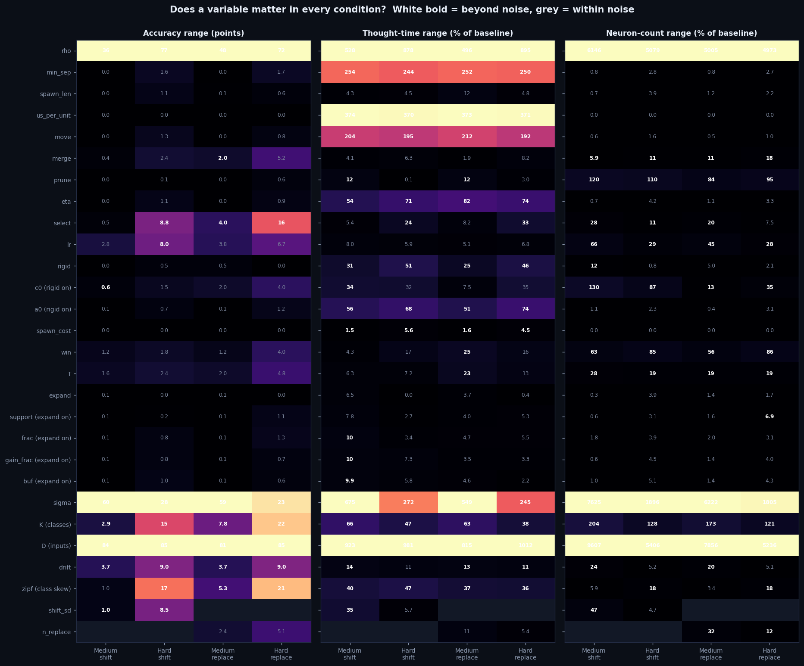
*Does a setting matter in every kind of task? Each cell is the effect size in one task. Bold white numbers are real effects, grey are luck.*

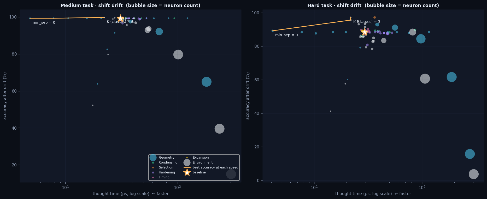
*Every setting we tested as a dot: further left is faster, higher is more accurate, bigger bubble is a bigger brain. The orange line is the best accuracy available at each speed.*

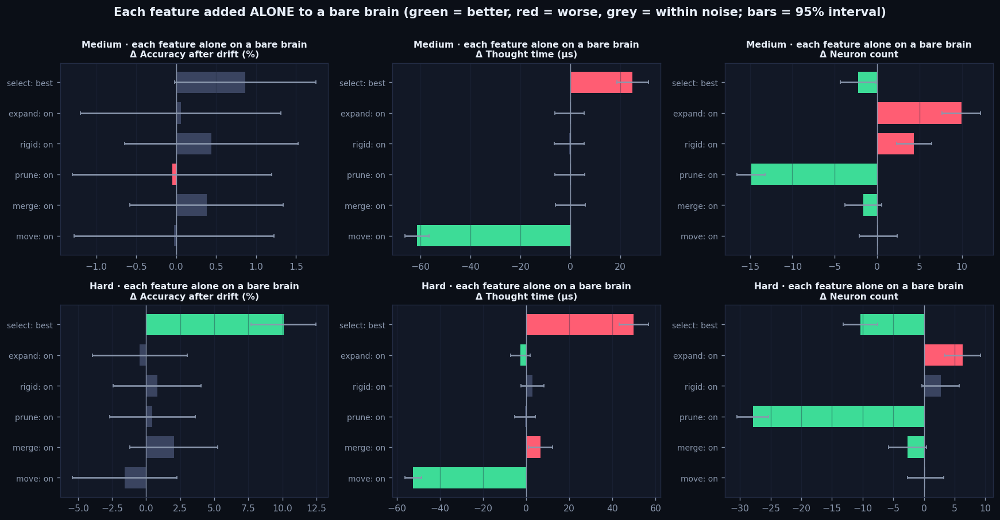
*Each feature added alone to a bare brain. Green bars help, red bars hurt, grey bars are luck. Moving makes thought faster, pruning makes the brain smaller, the expansion drive only adds neurons.*

## Method notes and limits

- Baseline: rho 0.5 (0.7 on the hard task), movement/merge/prune on, "fastest neuron answers", learning rate 0.1, 6,000 experiences, cleanup every 200, world changes at the halfway point.
- Sub-settings (c0, a0, support, frac, gain_frac, buf) are compared with their feature switched on at the default value.
- The simulator was extended to expose three constants that were hard-coded (size of the slide, class skew, number of replaced categories); it reproduces the original bit for bit at the defaults.
- Toy task: nothing here is evidence about real brains. Accuracy is frequency-weighted, and the fitness score F uses the original author's weights.
- Not yet tested: interactions between settings (this was one at a time). The Lab will let you design those tests.